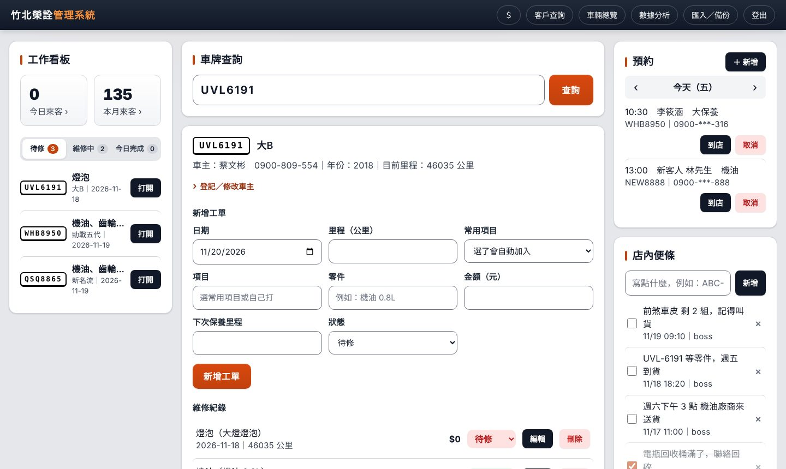
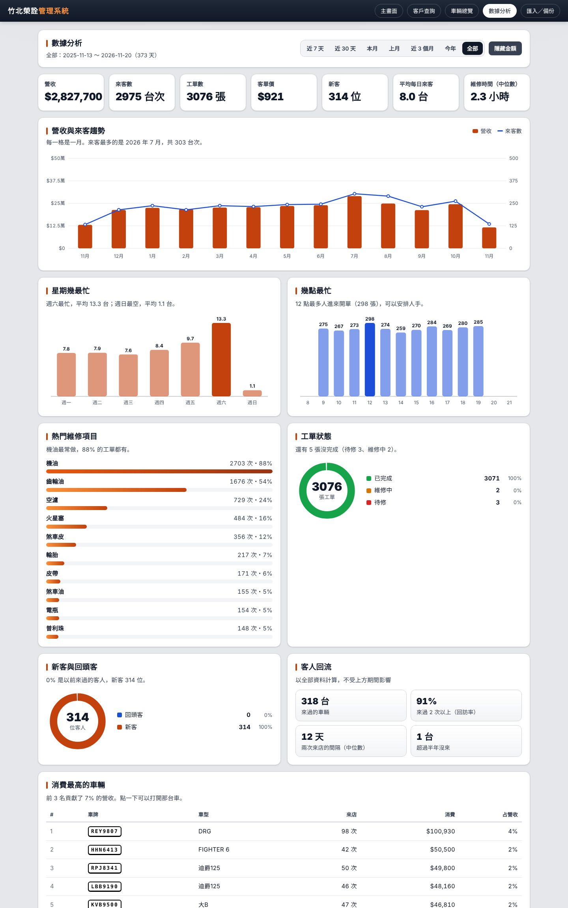
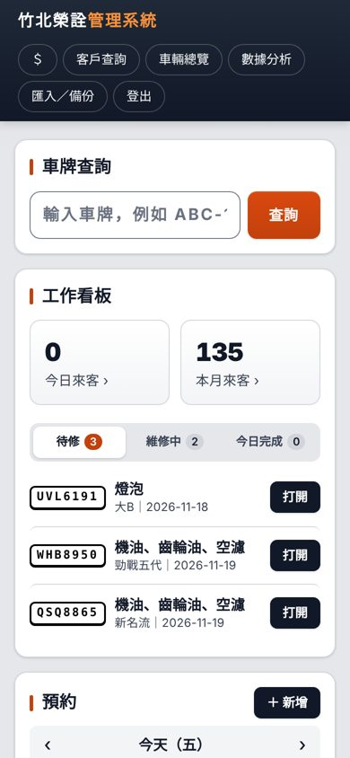
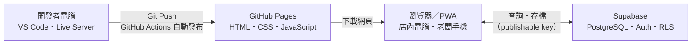
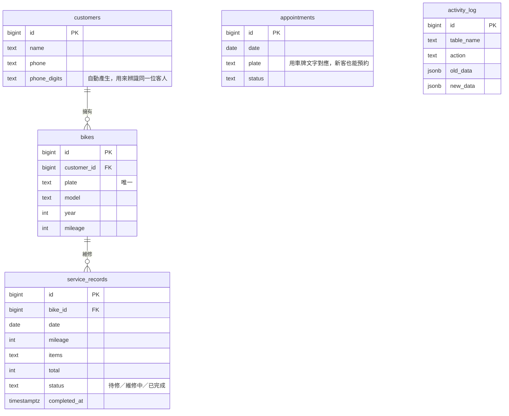

# 竹北榮詮機車行管理系統

> 這是**老闆版**：比推甄版多了修改／刪除車輛、編輯／合併／刪除客戶、修好通知車主、每日自動備份。設定方式請看〈[老闆版設定說明](老闆版設定說明.md)〉。

給在地機車行用的營運系統：**用車牌查詢維修紀錄、追蹤工單進度、自動統計來客數與營收**，取代原本「一台車一個 Excel、收錢另外手寫」的作法。電腦、手機都能用，也能安裝成 App。

🔗 線上版本：<https://jw-liou.github.io/moto-shop-boss/>（需要店家帳號才能登入；以下截圖皆為模擬資料）



## 為什麼做這個

店家原本的資料散在很多個 Excel 檔（檔名是車牌），金額另外手寫，因此：

- 查不到一位客人有幾台車、累計花了多少
- 算不出每天、每月來了幾台車、收了多少錢
- 資料只在店裡那台電腦，電腦壞了就沒了

這套系統把資料集中到雲端資料庫，以車牌為查詢入口、以電話辨識同一位客人，統計由系統自動計算，舊 Excel 也能直接匯入。

## 功能

| 頁面 | 功能 |
| --- | --- |
| 主畫面 | 車牌查詢、新車建檔、登記車主、新增／編輯／刪除工單、常用項目下拉選單、輸入檢查（里程倒退、金額為負、重複開單等） |
| 工作看板 | 今日／本月來客（點進去看來客名單）、待修／維修中／今日完成 |
| 預約與便條 | 今日預約（到店時自動帶入資料）、店內交班便條 |
| 今日營收 | 平常隱藏，按 ＄ 才顯示，1 分鐘自動關閉（櫃台電腦客人看得到） |
| 客戶查詢 | 用電話、車牌或姓名找客戶，看他名下所有車輛與累計消費 |
| 車輛總覽 | 熱門項目與車型排行、營收明細、工單明細、匯出 Excel |
| 數據分析 | 營收與來客趨勢、星期與時段分布、新客與回頭客、回訪率、車齡與里程分布、預約到店率，可切換期間並與前期比較 |
| 匯入／備份 | 舊保養表 Excel 匯入、一鍵備份全部資料、垃圾桶（180 天內可救回）、操作紀錄 |

<p>
  
  
</p>

## 系統架構

不自架伺服器：網頁放在 GitHub Pages，資料、登入與權限交給 Supabase，瀏覽器直接與資料庫溝通。



## 資料庫設計



另有 `notes`（店內便條）與 `staff`（員工名單）。資料庫以唯一鍵、檢查條件、外鍵確保資料正確，就算網頁的檢查被繞過也存不進錯誤資料。

## 安全與隱私

- **列層級安全（RLS）**：每張表都只允許「在員工名單上的登入帳號」讀寫；網頁程式碼與公開金鑰公開也拿不到資料
- **金鑰管理**：網頁只放受 RLS 限制的 publishable key，可以繞過權限的 secret key 不放進任何程式碼
- **關閉公開註冊**：帳號只能由管理端建立
- **防 XSS**：資料一律用 `textContent` 顯示
- **櫃台隱私**：營收預設隱藏、電話遮罩（`0912-***-678`）、數據分析頁金額預設模糊
- **操作紀錄與垃圾桶**：資料庫觸發器自動記錄每次新增、修改、刪除；刪除的資料 180 天內可救回
- 開發與測試一律使用模擬資料，不使用真實客戶個資

## 技術

| 用途 | 技術 |
| --- | --- |
| 前端 | HTML、CSS（Grid 響應式版面）、原生 JavaScript |
| 後端 | Supabase：PostgreSQL、Auth、Row Level Security、PL/pgSQL 觸發器與函式 |
| 部署 | GitHub Pages、GitHub Actions |
| 行動裝置 | PWA（manifest、Service Worker） |
| 圖表 | 自己用 SVG 繪製，不依賴圖表套件 |
| Excel | SheetJS（匯入、匯出、備份） |

## 檔案結構

```
index.html          登入
app.html            主畫面：車牌查詢、新車建檔、工單、工作看板、預約、便條、來客名單
bikes.html          車輛總覽
customers.html      客戶資料、合併、綁定 LINE
inventory.html      庫存、進貨、叫貨、用量分析
booking.html        線上預約設定、店家資訊
analytics.html      數據分析
import.html         匯入舊 Excel、一鍵備份、垃圾桶
owner.html          老闆專區（隱藏，要密碼）
customer/           客人網站（查保養紀錄、線上預約）
style.css           共用樣式
js/config.js        Supabase 連線設定
js/ui.js            共用畫面效果（導覽列、提示、老闆專區入口）
js/assistant.js     AI 小助理
js/models.js        車型選單
icons/              App 圖示
sw.js / manifest.json   讓網站可以「安裝」成 App（這兩個要放在最外層）
sql/                依編號 1→7 在 Supabase 執行；測試資料/ 是模擬資料和清除用的
supabase/functions/ AI 小助理的後端
scripts/backup.py   每天自動備份（.github/workflows/backup.yml 排程）
docs/               README 截圖
```

## 測試

- 以一整年的模擬資料（約 350 位客戶、3,000 張工單、250 筆預約）做壓力測試：資料庫約 8.6 MB（免費方案上限 500 MB），數據分析切換期間約 0.02～0.05 秒
- 資料超過 Supabase 單次 1,000 筆上限時，以分頁方式讀取，統計仍正確
- 以無頭瀏覽器在電腦與手機寬度實際操作各頁，確認沒有錯誤
- 權限測試：非員工帳號讀不到資料、無法救回或偽造操作紀錄

## 開發方式

本專案由我（JW-Liou）獨立完成需求觀察、分析、資料庫設計、測試與部署，開發過程使用 AI 工具（Claude）輔助撰寫程式與學習。需求取捨（例如不拆工資與零件費、全店共用一個帳號、營收要能藏起來）與每項功能的驗收由我決定並執行。

## 未來規劃

- 客人端線上預約（預約表已預留來源欄位）
- 人員帳號與權限分級
- 零件庫存管理
- 多店家共用（資料加上店家代碼，權限改為只看自己店）
